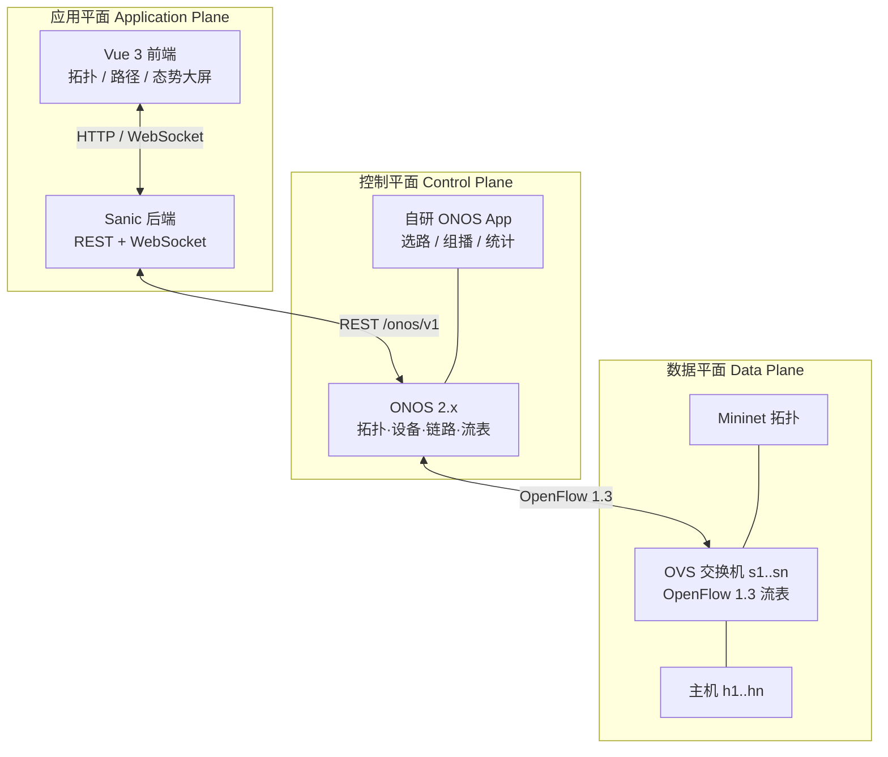
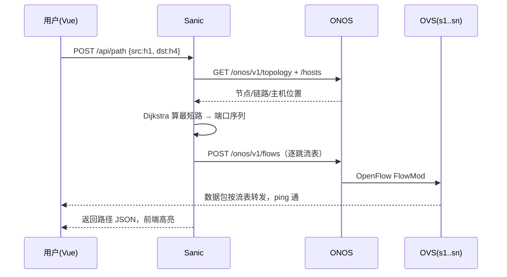
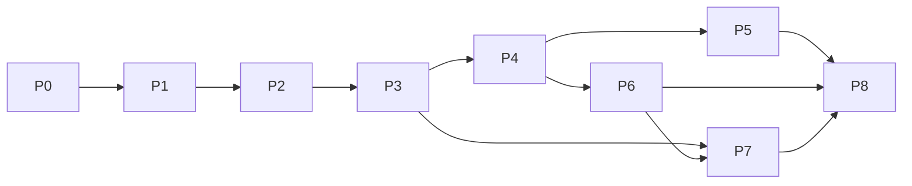

<title>软件定义网络 · 课程项目留痕</title>

# 一、课程逻辑总账

> 本文是「软件定义网络」课程项目的唯一事实来源。每次实操后按五段式追加：目的 / 命令 / 输出 / 结论 / 卡点。

> 版本：v0.1 ｜ 日期：2026-11-05 ｜ 维护：彭均涵 ｜ 飞书同步：待权限开通后自动写入  
> 本文件是「课程逻辑的唯一事实源」：后续大纲、实验、代码、答辩都从这里派生。

### 0. 结论先行（30 秒版）

- **本质**：传统网络里每台交换机各自学习、各自转发；SDN 把「怎么转发」这个决策收归一个「大脑」，交换机只执行大脑下发的流表。应用平面再把大脑包装成人能操作的产品。
- **交付物**：Mininet 拓扑（数据平面）+ ONOS（控制平面）+ Sanic/Vue（应用平面）+ 飞书过程留痕 + 期末答辩。
- **环境结论（2026-11-05 实测更正）**：WSL2 已能正常跑 Mininet（拓扑可起、ping 可通），原判断「WSL2 内核缺 openvswitch 模块」不适用于当前机器，保留仅作背景。
- **技术主线**：OpenFlow 1.3 流表为主，P4 只作拓展加分项。

### 1. 项目定义与边界

| 项 | 内容 |
|-|-|
| 项目名 | 三层软件定义网络管理系统（数据平面—控制平面—应用平面） |
| 一句话目标 | 给定拓扑，能让任意主机对按最优路径互通、能一对多组播、能看见链路状态 |
| 必须交付 | 可运行软件 + 源码仓库 + 飞书过程文档 + 答辩演示 |
| 不做 | 真实硬件交换机、生产级容灾、多租户计费、P4 全量编程 |
| 评分锚点 | 功能可演示 + 路径可解释 + 代码可运行 + 过程可追溯 |

### 2. 三层架构与职责



| 层 | 职责 | 本项目落地物 | 判断「做完了」的信号 |
|-|-|-|-|
| 数据平面 | 按流表匹配+动作转发；可被查询统计 | Mininet 拓扑、OVS 网桥、流表 | `ovs-ofctl dump-flows` 能看到下发结果，`n_packets` 在涨 |
| 控制平面 | 发现拓扑、维护全局视图、算路、下发流表 | ONOS 实例 + 自研 App | REST 能查到 devices/links/hosts，流表能经 ONOS 落地 |
| 应用平面 | 把网络能力变成人可用的接口与界面 | Sanic API + Vue 页面 | 浏览器点两下就能选路并看到高亮 |

### 3. 技术栈矩阵

| 层 | 技术 | 建议版本 | 职责 | 已知风险 |
|-|-|-|-|-|
| 仿真 | Mininet | 2.3.0 | 一键造拓扑、接入 OVS | 依赖内核 OVS 模块（当前卡点） |
| 数据平面 | Open vSwitch | 2.17（Ubuntu 22.04 自带） | 流表执行、OpenFlow 1.3 | WSL2 内核缺模块 |
| 控制平面 | ONOS | 2.x LTS（P2 阶段锁定，Java 11） | 拓扑/设备/链路、流表下发 | 内存 ≥4GB；Java 版本必须匹配 |
| 应用后端 | Sanic + Python | Sanic 24.x / Python 3.11 | 工业级异步 IO、聚合 ONOS API | Windows 与 Linux 路径差异 |
| 应用前端 | Vue 3 + Vite + ECharts | Vue 3.5 / Vite 6 | 拓扑图、路径高亮、态势大屏 | 跨域、WebSocket 断线重连 |
| 留痕 | 飞书云文档 | — | 过程记录、答辩材料 | 应用权限需开通 docx |

### 4. 功能分级（课程要求 → 可验收条目）

| 级别 | 课程原话 | 技术落地 | 验收信号（可执行） |
|-|-|-|-|
| L1 必做 | 硬编码请求下，单对单最优路径 | 拓扑建模 + Dijkstra + 流表下发 | 指定 h1→h4，ping 通且路径与算法一致；`dump-flows` 可见 |
| L2 进阶 | 多个单对单 | 多流并发、cookie/priority 隔离、超时回收 | 同时 3 组主机对互通，互不干扰；删除一条不影响其他 |
| L3 再进阶 | 单对多组播、广播 | Group Table（`group_id` + `actions=bucket`）、组播树 | 一发多收：h1 发 1 个包，h2/h3/h4 同时收到 |
| L4 进一步 | 数据平面态势感知 | 端口统计轮询 / sFlow / 链路利用率 / 阈值告警 | 页面 5 秒刷新利用率；人为打满链路触发告警 |

**我的野心（在 L1–L4 之上，按时间取舍）**

1. **意图级 API**：不只传 src/dst，而是「让 h1 到 h4 走低延迟/少跳路径」，后端翻译成约束。
2. **故障自愈**：链路 down 后自动重算并切换，页面 3 秒内反映。
3. **态势大屏**：拓扑热力图 + 流量趋势 + 告警列表，答辩时最有观感。

### 5. 一次完整请求的数据流（L1 走查）



关键认知：**应用平面不直接碰交换机**，它只跟 ONOS 说「我想要什么」；ONOS 负责翻译成 OpenFlow。这就是「控制平面」存在的意义。

### 6. 当前进度快照（2026-11-05）

| 项 | 状态 | 证据 |
|-|-|-|
| 课程逻辑梳理 | ✅ 本文档 | 本文件 |
| 教学大纲 | ✅ 见 `01-教学大纲.md` | 文件 |
| 环境 | ✅ 可用 | WSL2 实测可起 Mininet 拓扑并 ping 通 |
| Mininet/OVS 命令行 | 🟡 进行中 | 已跑 single 拓扑；流表受控实验进行中 |
| ONOS | ⬜ 未开始 | — |
| 应用平面 | ⬜ 未开始 | — |

### 7. 术语表（答辩要能脱口而出）

| 术语 | 一句话解释 |
|-|-|
| OpenFlow 1.3 | 控制器与交换机之间的南向协议；核心是 FlowMod（下发流表）与 PacketIn（上交未知包） |
| 流表项 | `match`（匹配哪些字段）+ `priority`（优先级）+ `actions`（干什么）+ 计数器 |
| OVSDB | OVS 的配置数据库协议；`ovs-vsctl` 就是在操作它 |
| Group Table | 一组动作桶，用于组播/负载均衡；`type=all` 即复制到所有桶 |
| ONOS | 开源的 SDN 控制器，Java 写的，带 GUI 和 REST |
| Intent | ONOS 的高层意图抽象（连通性/路径），由框架负责翻译成流表 |
| 态势感知 | 持续采集端口/流统计，推断拥塞、故障、异常 |

### 8. 留痕规范（飞书每次记录什么）

每次实验固定五段，**命令 + 输出必须贴原文**，不许只写「已成功」：

1. **目的**：这次要验证什么假设
2. **命令**：完整可复制的命令
3. **输出**：关键行原文（截图或文本）
4. **结论**：验证了/否证了什么
5. **卡点**：没通的地方 + 下一步

### 9. 里程碑与答辩锚点

| 里程碑 | 内容 | 答辩时怎么讲 |
|-|-|-|
| M1 | 环境 + 拓扑 + 手工流表 | 「我能不用控制器，纯命令行让两台主机通/不通」 |
| M2 | ONOS 接管，REST 可查拓扑 | 「控制器看到了全局视图」 |
| M3 | L1 最优路径闭环 | 「点一下，路径算出来并下发，ping 通」 |
| M4 | L2/L3 多流与组播 | 「一对多，一份流量多个接收者」 |
| M5 | L4 态势感知 | 「网络自己会说话：谁堵了、哪条链路满了」 |

### 10. 待确认清单

- [ ] WSL2 还是 VMware（环境决策，见 L1 课）

- [ ] ONOS 具体版本（P2 锁定）

- [ ] 答辩时间与演示时长

- [ ] 「特定语言」是否确指 OpenFlow 流表表达（已按此设计，P4 留拓展）

# 二、教学大纲

> 依据：`00-课程逻辑总账.md` ｜ 版本 v0.1 ｜ 按 6 周排，可按答辩日期压缩  
> 原则：**每个阶段都必须有「可执行命令 + 可观察输出」的验收信号**，没有信号不算完成。

### 0. 总览

| 阶段 | 主题 | 核心问题 | 验收信号 | 预计 |
|-|-|-|-|-|
| P0 | 环境基座 | 能不能跑起一个拓扑？ | `sudo mn --test pingall` 0% dropped | 2–3 天 |
| P1 | 数据平面手操 | 流表到底怎么决定转发？ | 手工下发流表让 h1↔h3 通、h1↔h2 不通 | 3 天 |
| P2 | 控制平面 | ONOS 怎么看见全网？ | `curl /onos/v1/devices` 返回全部交换机 | 4 天 |
| P3 | 应用平面打通 | 前端怎么看见网络？ | 浏览器出现拓扑图，节点=交换机 | 4–5 天 |
| P4 | L1 单对单最优路径 | 点一下，路径怎么算出来并生效？ | 任意 host 对 ping 通且路径可解释 | 5 天 |
| P5 | L2 多流并发 | 多条路径怎么互不干扰？ | 3 组同时通，删一条不影响其他 | 3 天 |
| P6 | L3 组播/广播 | 一份流量怎么发给多个接收者？ | h1 发 1 包，h2/h3/h4 同时收到 | 4 天 |
| P7 | L4 态势感知 | 网络状态怎么被看见和告警？ | 页面 5 秒刷新利用率，打满触发告警 | 5 天 |
| P8 | 集成与答辩 | 怎么讲清楚、演得稳？ | 15 分钟演示脚本跑通 | 4 天 |

> 时间不够时的取舍顺序：P4 > P6 > P7 > P5。**P0–P4 是底线，不能砍。**

### P0 环境基座（2–3 天）

**学习目标**

- 说清「Mininet 造的是什么、OVS 在中间扮演什么」
- 理解为什么 Windows 不能直接跑 Mininet（Linux 内核网络栈 + OVS 内核模块）

**实操**

1. 环境体检：确认发行版、内核、`CONFIG_OPENVSWITCH`、Mininet/OVS 版本
2. 解决 OVS 内核模块（VMware 虚拟机 或 WSL2 自编译内核）
3. 跑通 `sudo mn --test pingall`

**验收标准**

```bash
sudo mn --test pingall        # 期望：Results: 0% dropped
ovs-vsctl show                # 期望：能看到网桥与端口
```

**产出**：飞书一条「环境体检 + 决策理由」记录。

### P1 数据平面手操（3 天）

**学习目标**

- 流表项三要素：`match` / `priority` / `actions`
- 会读 `ovs-ofctl dump-flows`，会用 `ofproto/trace` 解释「这个包为什么被丢」
- 理解 table-miss、fail-mode（secure vs standalone）

**实操**

1. 起 `single,3` 拓扑（无控制器），观察空流表 → ping 不通
2. `add-flow actions=flood` → 通；再改成精确端口转发
3. 断链实验：`link s1 h2 down`，观察流表与连通性变化
4. `ofproto/trace` 追踪一个包的决策路径

**验收标准**

```bash
# 只允许 h1<->h3 通，h1<->h2 不通
sh ovs-ofctl add-flow s1 priority=10,in_port=1,actions=output:3
sh ovs-ofctl add-flow s1 priority=10,in_port=3,actions=output:1
h1 ping -c 2 h3    # 期望通
h1 ping -c 2 h2    # 期望 100% loss
```

**产出**：一份「流表实验记录」+ 一张端口/流表示意图。

### P2 控制平面 ONOS（4 天）

**学习目标**

- ONOS 架构：南向（OpenFlow/OVSDB）、核心（拓扑/主机/流表）、北向（REST）
- 会用 REST 查 `devices / links / hosts / topology / flows`
- 知道 ONOS 的认证方式（`onos:rocks`）

**实操**

1. 安装并启动 ONOS（Java 11），打开 `http://<ip>:8181/onos/ui`
2. Mininet 指定远程控制器：`sudo mn --controller=remote,ip=<onos-ip>,port=6653`
3. GUI 里看到拓扑；REST 拿到设备列表
4. 观察 ONOS 自动下发的流表（`table=0` 的 table-miss 与 LLDP 流）

**验收标准**

```bash
curl -u onos:rocks http://<onos>:8181/onos/v1/devices | jq '.devices | length'
# 期望：等于交换机数量
```

**产出**：ONOS 拓扑截图 + REST 返回样例。

### P3 应用平面打通（4–5 天）

**学习目标**

- Sanic 异步 IO 模型（为什么要它，而不是 Flask）
- ONOS REST 封装：统一错误处理、超时、重试
- Vue 组件化 + ECharts graph 画拓扑

**实操**

1. Sanic 起 `/api/topology`，代理 ONOS，返回前端友好的 JSON
2. Vue 页面拉取并渲染节点/边
3. 加自动刷新（3–5 秒轮询或 WebSocket）
4. 跨域（CORS）与本地开发代理

**验收标准**

- 浏览器打开页面，能看到与 Mininet 一致的拓扑（节点数、边数）
- 停掉一台交换机，页面 5 秒内变灰

**产出**：可访问的前端页面 + API 文档（OpenAPI 或 README）。

### P4 L1 单对单最优路径（5 天）★核心

**学习目标**

- 把 ONOS 拓扑转成带权图（边权=跳数/延迟/带宽）
- Dijkstra 求最短路，并把「路径」翻译成「逐跳流表」
- 端到端闭环：前端请求 → 后端算路 → ONOS 下发 → ping 验证

**实操**

1. 后端实现 `GET /api/path?src=h1&dst=h4`（先只读，不改网络）
2. 实现流表下发：按路径每一跳生成 `match(in_port, eth_dst) → output(port)`
3. 前端画出高亮路径
4. 对比：不选路（默认 flood）vs 选路（精确转发）的 `dump-flows`

**验收标准**

```bash
curl 'http://localhost:8000/api/path?src=h1&dst=h4'
# 期望：返回 ["s1","s2","s4"] 之类的路径
sudo mn ... ; h1 ping -c 3 h4   # 期望：0% loss
ovs-ofctl dump-flows s1 | grep <h4的MAC>  # 期望：命中计数增长
```

**产出**：演示视频/截图 + 算法说明（为什么 Dijkstra 够用/不够用）。

### P5 L2 多流并发（3 天）

**学习目标**

- 流表隔离：`priority`、`cookie`、`idle_timeout`
- 多请求并发下的状态管理（避免互相覆盖）

**实操**

1. 同时为 3 组主机对算路并下发，用不同 `cookie` 标记
2. 提供 `DELETE /api/path/{cookie}` 精确回收
3. 压测：连续下发 50 条不串味

**验收标准**

- 3 组 ping 同时通，`dump-flows` 可区分 cookie
- 删除其中一条，其余不受影响

### P6 L3 组播/广播（4 天）

**学习目标**

- Group Table：`group_id`、`type=all/select`、`bucket=actions`
- 组播树：在拓扑上求「源到多目的」的树（Steiner 近似或最短路并集）

**实操**

1. 计算以 h1 为根的组播树
2. 逐跳下发 `group` 流表（`actions=group:<id>`）
3. 验证：h1 发一个包，h2/h3/h4 同时收到（`iperf -u -b 1M` 或 `ping` 多播地址）
4. 对比广播（`actions=flood` 或 `output:CONTROLLER`）

**验收标准**

```bash
h1 ping -c 2 224.0.0.1   # 组播组
# h2/h3 侧抓包均能看到（tcpdump -i h2-eth0）
ovs-ofctl dump-groups s2  # 期望：存在 group，桶数=下游分支数
```

**产出**：组播树示意图 + 抓包证据。

### P7 L4 态势感知（5 天）

**学习目标**

- 端口统计（`OFPT_PORT_STATS`）与流统计的采集方式
- 利用率计算：`(Δbytes×8) / (Δt×带宽)`
- 阈值告警与前端可视化

**实操**

1. Sanic 定时任务轮询 ONOS 统计接口（或 OVS `ovs-ofctl dump-ports`）
2. 维护时间序列（内存环形缓冲即可，不必上数据库）
3. 前端：链路颜色随利用率变化 + 趋势图 + 告警列表
4. 人为制造拥塞：`iperf` 打满一条链路，观察变色与告警

**验收标准**

- 页面 5 秒刷新，链路颜色与 `iperf` 实际带宽一致（误差 <20%）
- 超过阈值（如 80%）出现告警条目，降下来后自动恢复

### P8 集成与答辩（4 天）

**学习目标**

- 一键启动（脚本统一拉起 Mininet/ONOS/Sanic/Vue）
- 演示脚本：3 分钟讲架构、7 分钟演功能、5 分钟答问

**实操**

1. `make demo` 或 `scripts/start-all.sh` 一键起环境
2. 录制备份视频（防现场翻车）
3. 准备「为什么这么设计」的 10 个问答

**验收标准**

- 全新机器按 README 能在 30 分钟内跑起来
- 演示脚本零手动补救跑通

### 每日节奏建议

| 时段 | 做什么 |
|-|-|
| 上午 | 学概念（30 分钟）+ 跑命令（90 分钟），记录输出 |
| 下午 | 写代码/搭功能，遇到卡点先记录再求助 |
| 晚上 | 飞书留痕 5 分钟：目的/命令/输出/结论/卡点 |

### 阶段之间的依赖



# 三、任务拆解：单对单通信（L1）做到「能写代码」的粒度

## 3.1 先把问题缩到最小

L1 的完整链路其实只有三问。把这三问答完，代码就能落地：

| 问题 | 产出物 | 归属 |
|-|-|-|
| 网络怎么存？ | topology.yaml + 内存图 | A（拓扑）/ C（数据结构） |
| 路径怎么算？ | hops 列表（含端口） | C |
| 流怎么下发？ | FlowMod 列表 → OVS | B |

一句话：**把网络变成图，把图变成路径，把路径变成流表。** 三层架构听起来抽象，落到代码就是这三步。

## 3.2 第一层：拓扑的「声明」（唯一事实源）

拓扑不要写死在三个地方，只写一份 YAML，三处消费（Mininet 建网、后端建图、ONOS 对账）：

```yaml
switches:
  - {id: s1, dpid: "0000000000000001"}
  - {id: s2, dpid: "0000000000000002"}
hosts:
  - {id: h1, ip: 10.0.0.1, mac: "00:00:00:00:00:01", attach: s1, port: 1}
  - {id: h2, ip: 10.0.0.2, mac: "00:00:00:00:00:02", attach: s2, port: 1}
links:
  - {src: s1, src_port: 3, dst: s2, dst_port: 1, bw: 10, delay: 2}
```

三条硬约束，少一条后面必翻车：

| 约束 | 为什么 |
|-|-|
| 端口号写死 | Mininet 的端口顺序决定 OVS 端口号；不写死，流表就不可复现 |
| dpid 固定 | ONOS 用 dpid 认设备，拓扑重启不能换号 |
| 主机 IP/MAC 写死 | 后端算路、流表 match、抓包验证都要用同一个值 |

## 3.3 第二层：内存里的图

```python
Node  = {id, kind: "switch" | "host", dpid, ports: {port_no: (peer_id, peer_port, cost)}}
Link  = (u, u_port, v, v_port, cost)
Graph = {nodes: dict[str, Node], adj: dict[str, list[Link]]}
```

三个设计决定，答辩时都会被问「为什么」：

| 决定 | 理由 |
|-|-|
| 邻接表，不用邻接矩阵 | 课程拓扑 ≤ 20 节点、极稀疏；邻接表 O(V+E) 空间，Dijkstra 只遍历真实存在的边 |
| 一条链路存两条有向边 | 流表是单向的，去程回程要分别下发；图也必须能单向查 |
| 端口挂在边上，不挂在节点上 | 同一对交换机之间可能有多条链路（L2 要考），端口是「边」的属性而不是「点」的 |

## 3.4 第三层：路径对象

```python
Hop  = {sw: "s1", in_port: 1, out_port: 3}
Path = {src: "h1", dst: "h2", nodes: ["s1", "s2"], hops: [Hop, ...], cost: 2}
```

**关键约束**：hops 的长度 = 路径上交换机个数；每个 hop 必须自带 `in_port` 和 `out_port`。

只存节点序列（`["s1","s2"]`）是新手最常踩的坑——到了下发流表那一步，你不知道从哪个口出去，只能回头重算。

## 3.5 第四层：流表项

```python
FlowMod = {
  "switch": "s1",
  "priority": 100,
  "match": {"in_port": 1, "eth_type": 0x0800, "ipv4_dst": "10.0.0.2"},
  "actions": [{"type": "OUTPUT", "port": 3}],
  "idle_timeout": 0
}
```

三条规则：

1. **入口交换机**额外 match `ipv4_dst`；**中间交换机**只 match `in_port` 就够（同一条路径中间不会分叉）。
2. **必须双向装**：h1→h2 一套，h2→h1 一套（src/dst 对调、端口反向），否则 ping 只有去没有回。
3. **表项数 = 2 × 路径跳数**，这是答辩时能被追问的点，先算清楚。

## 3.6 算法：Dijkstra 最小实现

```python
import heapq

def dijkstra(g, src, dst):
    dist = {src: 0}
    prev = {}                      # v -> (u, link)
    pq = [(0, src)]
    while pq:
        d, u = heapq.heappop(pq)
        if u == dst:
            break
        if d > dist.get(u, float("inf")):
            continue
        for e in g.adj[u]:
            nd = d + e.cost
            if nd < dist.get(e.v, float("inf")):
                dist[e.v] = nd
                prev[e.v] = (u, e)
                heapq.heappush(pq, (nd, e.v))
    return rebuild_path(prev, src, dst)   # 回溯时同时取出端口
```

三个坑：

1. 权重默认是 1（跳数）；到 P7 态势感知再换成时延，接口不用改。
2. 回溯时必须带端口，否则又回到 3.4 的坑。
3. 主机是端点，不参与 Dijkstra；把 h1 当作起点、h2 当作终点即可。

## 3.7 接口契约（组内对接的唯一凭据）

| 接口 | 方法 | 请求 | 响应 |
|-|-|-|-|
| `/topology` | GET | 无 | `{nodes: [...], links: [...]}` |
| `/path` | POST | `{src: "h1", dst: "h2"}` | `{nodes: [...], hops: [...], cost: 2}` |
| `/flow/install` | POST | `{src: "h1", dst: "h2"}` | `{installed: 4, flows: [...]}` |

规则：**先定接口，再写代码**；谁改接口，谁在群里通知另外两人。这条比任何技术选型都重要——四人协作翻车，九成是接口没定死。

## 3.8 验收信号（三行证据）

| 层 | 命令 | 期望 |
|-|-|-|
| 数据平面 | `ovs-ofctl -O OpenFlow13 dump-flows s1` | 出现 match in_port / output 的对应表项 |
| 控制平面 | `curl -s ONOS:8181/onos/v1/topology` | 返回设备与链路 |
| 应用平面 | `curl -X POST api:8000/path -d '{"src":"h1","dst":"h2"}'` | 返回 hops，且与 A 手工下发的路径一致 |
| 端到端 | `mininet> h1 ping -c3 h2` | 0% packet loss；`del-flows` 后变 100% |

---

# 四、A / B / C / D 分工

按「平面」分，不按「功能」分——三层架构本身就是答辩要讲的结构，四个人各守一层，边界最清楚。

| 成员 | 负责平面 | 本阶段（L1）交付物 | 验收信号 | 依赖 |
|-|-|-|-|-|
| **A** | 数据平面 | `topology.yaml`、Mininet 自定义拓扑脚本、OVS 手工流表实验记录 | 拓扑能起；`dump-flows` 与手工脚本一致 | 无（最先动） |
| **B** | 控制平面 | ONOS 安装、拓扑 REST 打通、流表下发接口 | `curl ONOS/topology` 有设备；下发后 `dump-flows` 变化 | A 的 dpid 与端口表 |
| **C** | 应用后端 | Graph 数据结构、Dijkstra、Sanic 三个接口 | `curl /path` 返回正确 hops，与 A 手工路径一致 | A 的 yaml |
| **D** | 前端 + 验证 | Vue 拓扑图与路径高亮、端到端测试脚本、飞书留痕 | 页面点 h1→h2 能高亮路径；脚本一键跑通 | C 的接口 |

# 五、阶段留痕记录

| 阶段 | 时间 | 目的 | 关键命令 | 结果 | 结论 / 卡点 |
|-|-|-|-|-|-|
| P0 环境基座 | 2026-11-05 | 验证 WSL2 能否跑 Mininet | `sudo mn --mac --controller=none` | 拓扑正常启动，pingall 首次 100% 丢包、二次 0% | 环境可用；转发方式待用 fail_mode / dump-flows 判定 |
| P1 数据平面手操 | 待填 | 手工流表接管转发 | 待填 | 待填 | 待填 |